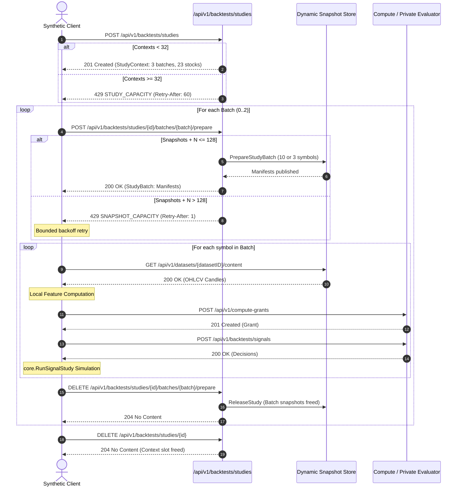

# Signal-Study Sustained Workload Specification and Measurement

## Architecture and Boundary Limits

SignalGen bounds historical signal-study memory and compute consumption through deterministic limits enforced across the API layer and the dynamic snapshot dataset store:

| Resource Dimension | Limit | Enforcement Point | Behavior on Saturation |
| --- | --- | --- | --- |
| Active Study Contexts | 32 total (1 per user session) | `backend/internal/api/backtests/studies.go` | HTTP 429 `STUDY_CAPACITY`, `Retry-After: 60` |
| Dynamic Snapshot Slots | 128 total (`MaxEntries: 128`) | `backend/internal/dataset/study_capacity.go` | HTTP 429 `SNAPSHOT_CAPACITY`, `Retry-After: 1` |
| Batch Size | 10 symbols per batch (atomic admission) | `backend/internal/api/backtests/studies.go` | Whole-batch atomic admission; all 10 slots reserved before provider fetch |
| Context Expiry | 2 hours TTL | `backend/internal/api/backtests/studies.go` | Expired contexts pruned on creation and batch operations |
| Snapshot Entry TTL | 1 minute default / 8s reservation deadline | `backend/internal/dataset/study_capacity.go` | Staged reservations cancelled on timeout; expired entries pruned under store lock |

The prior `TestStudySyntheticHTTPAdmission` tested a single admission wave across user counts (1 to 1000), confirming that an initial wave of 1,000 requests admits 32 contexts (rejecting 968) and prepares 12 complete first batches (120 snapshots, refusing 20). That wave test measured only initial admission; it did not measure completed-user sustained throughput, client evaluation, batch release, context cancellation, retry backoff, or capacity recovery.

## Full HTTP Lifecycle

The sustained workload executes the real HTTP handlers over loopback through the standard Go `net/http` client and server stack:



## Correctness Invariants and Recovery Verification

The sustained workload suite in [`study_sustained_load_test.go`](../../backend/internal/api/tests/study_sustained_load_test.go) deterministically verifies:

1. **Strict Outcome Partitioning:** Every initiated attempt maps into exactly one category without duplicate counting:
   $$\text{attempts} = \text{completed} + \text{rejected} + \text{failed} + \text{cancelled}$$
2. **Admission Ceilings:** Observed peak in-flight contexts never exceed 32; peak in-flight snapshots never exceed 128 (typically 120 due to 10-symbol batch granularity).
3. **Overload Backpressure:** Context saturation returns 429 `STUDY_CAPACITY` with `Retry-After: 60`. Snapshot saturation returns 429 `SNAPSHOT_CAPACITY` with `Retry-After: 1`.
4. **Deterministic Recovery:** When active batches are released (`DELETE .../batches/{batch}/prepare`), retrying clients immediately obtain capacity without server restarts. When active contexts are cancelled (`DELETE .../studies/{id}`), rejected clients immediately obtain admission slots.
5. **Zero Context or Slot Leak:** After test completion, all active contexts in the handler and all dynamic entries and reservations in the store return to zero. Subsequent admission of 32 fresh contexts and 12 batches succeeds without resistance.

## Defect Investigation and Scoped Findings

An explicit investigation into the study context handler and dynamic store recovery paths confirmed:

- **Batch Release Semantics:** `DELETE /api/v1/backtests/studies/{id}/batches/{batch}/prepare` invokes `store.ReleaseStudy(owner, id)` and resets `item.activeBatch = -1`, successfully freeing all snapshot slots for subsequent clients.
- **Context Cancellation:** `DELETE /api/v1/backtests/studies/{id}` deletes the context from the handler registry and releases any surviving reservations or snapshots.
- **Error Cleanup:** When `PrepareStudyBatch` encounters capacity exhaustion, the staged reservation is closed under `defer r.closeLocked()`, preventing reservation leaks.
- **Outcome:** No scoped recovery defect was found in the tested HTTP handler and store lifecycle. Capacity recovers as designed when clients observe `Retry-After` backpressure and prior users complete or cancel. Because no defect was detected, no product code changes or paired optimization runs were necessary.

## Scope Boundaries and Synthetic Dependencies

- **Loopback In-Memory Execution:** Measurements reflect loopback HTTP execution (`net/http/httptest`) with synthetic fixtures for auth, sessions, entitlements, catalog, and daily OHLCV prices.
- **Synthetic Grant Storage:** Grants are held in an in-memory concurrent store verifying owner and session tokens; no persistent PostgreSQL database or production grant verification was evaluated.
- **No Production Capacity Claims:** These tests verify handler boundary limits (32 contexts, 128 snapshots), atomic admission, and overload recovery. They do not claim production or 1,000-user live system capacity.

## Measured Evidence References

- Primary Sustained Evidence (16 Nov 2026, >=5 s sustained per tier): [`docs/evidence/study-sustained-load-20261116.md`](../evidence/study-sustained-load-20261116.md) and [`docs/evidence/study-sustained-load-20261116.json`](../evidence/study-sustained-load-20261116.json).
- Historical Probe (18 Nov 2026, superseded brief burst probe): [`docs/evidence/study-sustained-load-20261118.md`](../evidence/study-sustained-load-20261118.md).

## Test Execution

Run the correctness and race tests directly in the isolated offline Docker environment:

```sh
sh backend/scripts/run_study_sustained_load.sh
```

Or execute Go test directly:

```sh
go test ./internal/api/tests -run TestStudySustainedWorkloadCorrectnessAndOverloadRecovery -v -count=1
go test -race ./internal/api/tests -run TestStudySustainedWorkloadCorrectnessAndOverloadRecovery -count=1
go vet ./internal/api/tests
```
